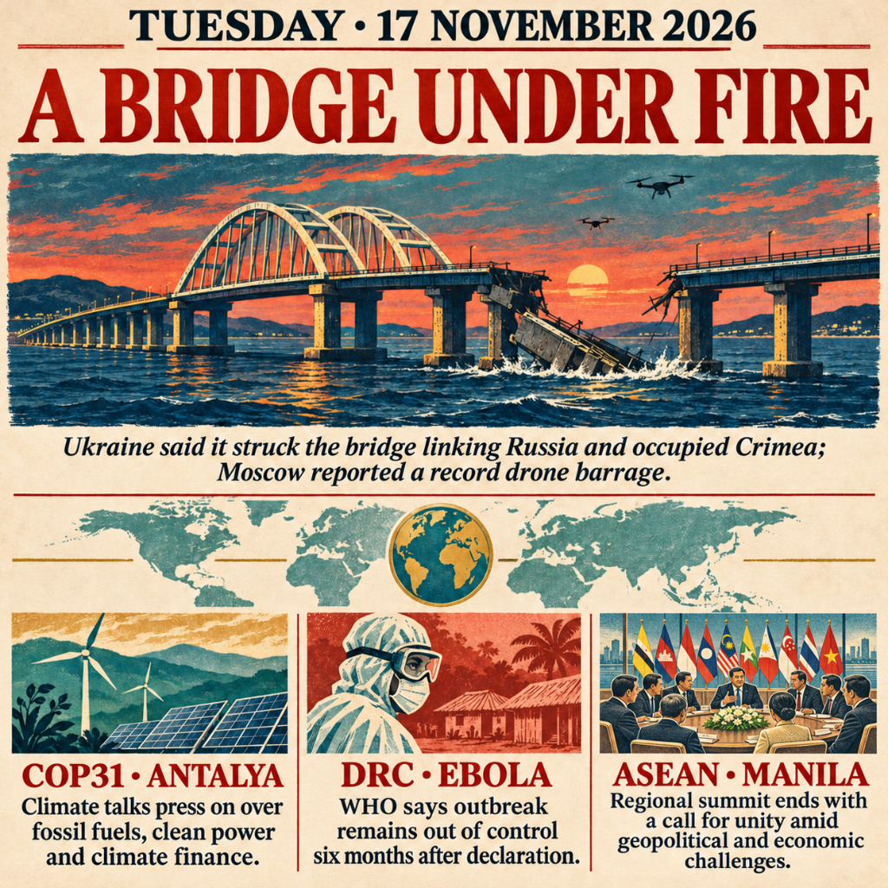

# November 17, 2026 — World News in One Image

An editorial front page for Tuesday, November 17, 2026, with four stories from three regions and several fields.

The lead is Ukraine's reported strike on the Kerch Bridge. Smaller panels cover COP31, the DRC Ebola outbreak, and the ASEAN summit in Manila.

Run on Node 22 with MAKEFUN_OUTPUT_DIR=out and node main.ts.
